# Awesome-Full-Stack-Web-Development-Frameworks

  

  

  

  

  

  

# 🌐 Top Full-Stack Web Development & Frameworks

**Curated List of SaaS/Hosted Platforms & Open-Source GitHub Projects**  

*Focused on Full-Stack Meta-Frameworks, Unified Backend/API/Agent Engines, Self-Hosted PaaS Alternatives & Modern Edge/SSR Runtimes*  

**Last updated: November 2026**

This repository tracks notable **SaaS/Hosted platforms** and **open-source projects** for **Full-Stack Web Development & Frameworks**. These tools power full-stack SSR/edge web applications (`Next.js`, `Nuxt`, `SvelteKit`, `Astro`, `Remix / React Router`, `TanStack Start`), unified backend/API/event/AI-agent frameworks (`Motia`, `Laravel`, `Django`, `Ruby on Rails`), and self-hosted Vercel/Netlify PaaS alternatives (`Coolify`, `Dokku`, `CapRover`) for full-stack engineers, indie hackers, and platform teams.

**Examples** include AWS Amplify, Firebase Hosting (Google), GitHub Pages (Microsoft), Cloudflare Pages & Workers, Fastly Compute / Pages, Vercel, Netlify, Render, Fleek, and Surge.sh (the category leaders).

**🚀 Open-source emphasis**: This section is heavily expanded with every major active project for unified full-stack & backend frameworks (`Motia`, `Next.js`, `Nuxt`, `SvelteKit`, `Astro`, `Remix / React Router`, `TanStack Start`, `SolidStart`, `Laravel`, `Django`, `Ruby on Rails`, `Phoenix`, `AdonisJS`), self-hosted Vercel/Render PaaS platforms (`Coolify`, `Dokku`, `CapRover`, `Kamal`), and all-in-one backend-as-a-service (`Supabase`, `PocketBase`, `Appwrite`) — ideal for developers building scalable web apps without per-seat or bandwidth lock-in.

🤝 Contributions welcome! Open a PR to add/update entries. Keep descriptions factual and link to official sites.

## 📑 Table of Contents

- [📊 Sector Overview & Market Dynamics](#-sector-overview--market-dynamics)

- [☁️ SaaS/Hosted & Commercial Platforms](#️-saashosted--commercial-platforms)

- [💻 Open-Source GitHub Projects](#-open-source-github-projects)

- [🛠️ How to Contribute](#️-how-to-contribute)

- [⚠️ Disclaimer](#️-disclaimer)

- [💖 Support & Thank You](#-support--thank-you)

## 📊 Sector Overview & Market Dynamics

The global Full-Stack Web Development, Cloud PaaS & Edge Application Hosting market is valued at approximately **$28B–$35B+ in 2026**, expanding at a ~16%–21% CAGR driven by edge-first SSR frameworks, AI-assisted full-stack workflows, and unified API/event/agent runtimes. The commercial deployment layer exhibits **strong winner-take-most consolidation** around hyperscalers (AWS, Google, Microsoft/GitHub), edge networks (Cloudflare, Fastly), and developer-cloud leaders (Vercel, Netlify, Render), while the application framework and self-hosted PaaS layers are **overwhelmingly open-source led** (`Next.js`, `Nuxt`, `SvelteKit`, `Astro`, `Motia`, `Laravel`, `Django`, `Coolify`).

## ☁️ SaaS/Hosted & Commercial Platforms

*Sorted descending by company valuation / annual revenue scale.*

| Platform | Description | Company Scale (Valuation / Revenue) | Starting Paid Tier | Free Tier / Trial Limit |

| :--- | :--- | :--- | :--- | :--- |

| **[AWS Amplify](https://amazon.com)** | Full-stack cloud hosting, CI/CD, SSR framework deployment, and backend-as-a-service powered by AWS infrastructure. | **Part of Amazon / AWS** (~$115B+ AWS annual revenue; ~$2T+ parent market cap) | **Pay-as-you-go** (~$0.01/build min, **$0.15/GB served**, and $0.30/1M SSR requests) | **12-Month AWS Free Tier** (1,000 build minutes/month, **5 GB storage**, and **15 GB data transfer/month** free for 12 months) |

| **[Firebase Hosting (Google)](https://google.com)** | Fast, global CDN static and dynamic full-stack web hosting integrated natively with Cloud Run, Next.js, Angular, and Firebase Auth/Firestore. | **Part of Alphabet / Google Cloud** (~$350B+ Alphabet revenue; ~$2T+ parent market cap) | **Blaze Pay-as-you-go** ($0.026/GB storage + **$0.15/GB transfer** beyond free quota) | **Forever Free Spark Plan** (**10 GB SSD storage**, **360 MB/day (~10 GB/mo) data transfer**, custom domains, and free SSL) |

| **[GitHub Pages (Microsoft)](https://github.com)** | Zero-config static site and frontend web hosting deployed directly from GitHub repositories with GitHub Actions CI/CD. | **Part of Microsoft / GitHub** (~$2B+ GitHub ARR; ~$3T+ Microsoft market cap) | **$4 / user / month** for GitHub Team (unlocks private-repo GitHub Pages hosting) | **Forever Free for Public Repositories** (**1 GB site size limit**, **100 GB bandwidth/month**, 10 builds/hour, and custom HTTPS domains) |

| **[Cloudflare Pages & Workers](https://cloudflare.com)** | Edge-native full-stack deployment platform running static assets and serverless JavaScript/Wasm SSR functions across 330+ global cities. | **~$1.7B+ Annual Revenue** (~$35B–$45B+ public market cap on NYSE) | **$5 / month** for Workers Paid (includes 10M requests/mo + unlimited static bandwidth) | **Forever Free Plan** (**Unlimited sites, unlimited static requests, and unlimited bandwidth** + 100,000 Workers SSR requests/day) |

| **[Fastly Compute / Pages](https://fastly.com)** | High-performance edge cloud and WebAssembly full-stack compute platform offering instant cache purges and ultra-low-latency global delivery. | **~$540M+ Annual Revenue** (~$1B+ public market cap on NYSE) | **$50 / month** minimum usage commitment for standard commercial Compute/CDN accounts | **Forever Free Developer Tier** (Up to **$50/month in free usage credits** indefinitely for testing edge apps, KV, and static hosting) |

| **[Vercel](https://vercel.com)** | Premier frontend and full-stack cloud platform built by the creators of Next.js, offering instant Git previews, Fluid Compute, and edge middleware. | **$3.25B+ Valuation** (~$150M+ ARR) | **$20 / user / month** for Pro plan (includes 1 TB bandwidth & 1M serverless invocations) | **Forever Free Hobby Plan** (Non-commercial personal projects with **100 GB bandwidth/month**, 100k function invocations, and automatic SSL) |

| **[Netlify](https://netlify.com)** | Composable web platform and Git-centric CI/CD hosting service featuring serverless functions, edge middleware, forms, and split testing. | **~$2.0B Peak Valuation** (~$100M+ est. ARR) | **$19 / member / month** for Pro plan (includes 1 TB bandwidth & 25k build minutes) | **Forever Free Starter Plan** (**100 GB bandwidth/month**, 300 build minutes/month, 125k serverless function requests, and instant rollbacks) |

| **[Render](https://render.com)** | Modern unified cloud PaaS for hosting full-stack web services, background workers, cron jobs, static sites, and managed PostgreSQL/Redis. | **~$500M–$750M Est. Valuation** (~$50M+ est. ARR; $150M+ VC funding) | **$7 / month** for Starter web service (512 MB RAM) or **$19 / user / mo** Team + compute | **Forever Free Static Sites & Hobby Instances** (**100 GB bandwidth/mo** free for static sites + free spin-down web services & 90-day Postgres) |

| **[Fleek](https://fleek.xyz)** | Edge-optimized cloud and decentralized web/AI-agent hosting platform supporting static sites, serverless functions, and IPFS/ENS deployments. | **~$50M–$100M Est. Valuation** ($25M+ Series A funding led by Polychain) | **$20 / month** for Pro plan (higher bandwidth, build minutes, and custom domains) | **Forever Free Tier** (**3 GB storage**, **50 GB bandwidth/month**, 250 build minutes/month, and 3 projects free forever) |

| **[Surge.sh](https://surge.sh)** | Zero-friction, single-command CLI static web publishing service for frontend developers deploying HTML/CSS/JS bundles in seconds. | **Independent Bootstrapped SaaS** (Profitable developer CLI utility) | **$30 / month** for Surge Professional (unlimited projects, custom SSL, and password protection) | **Forever Free Plan** (**Unlimited public projects**, unlimited publishing via `surge` CLI, and custom `.surge.sh` or HTTP custom domains) |

## 💻 Open-Source GitHub Projects

| Project | License / Hosting Cost | Free Tier / Self-Hosted Limit | Description |

| :--- | :--- | :--- | :--- |

| **[Motia (`MotiaDev/motia`)](https://github.com)** | **Open-Source** ($0 self-hosted unified backend & AI-agent framework) | **100% Free forever** (Unlimited polyglot APIs, background jobs, event queues, and AI agent workflows in TypeScript/Python) | Modern unified backend framework uniting APIs, background jobs, event-driven workflows, and AI agents into a single observable primitive. |

| **[Next.js (`vercel/next.js`)](https://github.com)** | **MIT Open-Source** ($0 React full-stack framework) | **100% Free forever** self-hosted (Unlimited React Server Components, App Router, Server Actions, SSR/SSG, and Docker deployments) | The industry-standard React full-stack framework featuring hybrid static/server rendering, Server Actions, and edge middleware. |
